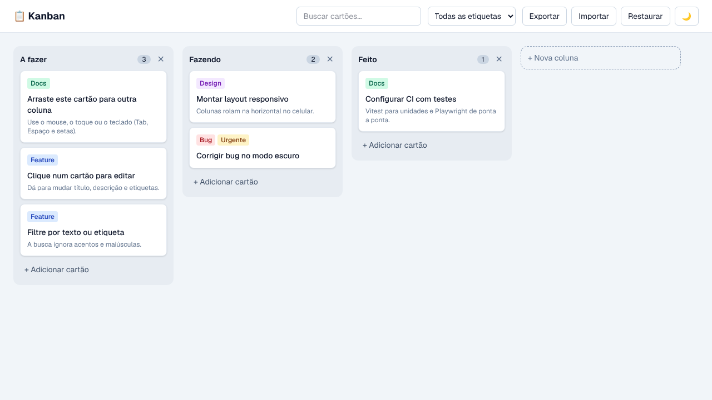
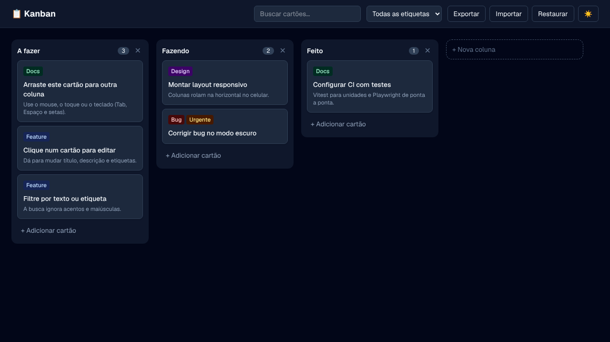

# Kanban Board

[](https://github.com/FelipeYabiko/kanban-board/actions/workflows/ci.yml)


Quadro **Kanban** para organizar tarefas: arraste cartões entre colunas com mouse, toque ou **teclado**, edite título,
descrição e etiquetas, filtre por texto ou etiqueta e alterne entre tema claro e escuro. Feito com **Next.js 16**,
**React 19**, **TypeScript** e **Tailwind CSS 4**, com testes unitários (**Vitest**) e de ponta a ponta (**Playwright**).

| Tema claro                               | Tema escuro                                |
| ---------------------------------------- | ------------------------------------------ |
|  |  |

## Funcionalidades

- **Arrastar e soltar** entre colunas e dentro delas ([dnd-kit](https://dndkit.com)), com prévia flutuante e Esc para
  cancelar
- **Acessível pelo teclado**: Tab para focar, Espaço para pegar e soltar, setas para mover, Enter para abrir; leitores
  de tela recebem anúncios em português
- **Edição** em um `<dialog>` nativo: título, descrição e etiquetas (Bug, Feature, Design, Docs, Urgente)
- **Colunas** que podem ser criadas, renomeadas e excluídas
- **Busca** que ignora acentos e maiúsculas, e **filtro por etiqueta**
- **Tema escuro** que respeita o sistema, é lembrado e não "pisca" ao carregar
- **Salva no navegador** (localStorage), sincroniza entre abas e permite **exportar e importar** em JSON
- **Responsivo**: no celular, as colunas rolam na horizontal

## Decisões técnicas

- **Estado fora do React com `useSyncExternalStore`.** O quadro vive num store pequeno que persiste no localStorage. No
  servidor não existe localStorage, então o HTML sai com um esqueleto e o quadro aparece na hidratação, sem erro de
  divergência ([`src/lib/store.ts`](src/lib/store.ts)).
- **Reducer puro e estado normalizado.** Colunas guardam só a ordem dos ids e os cartões ficam num mapa. Toda mudança é
  uma `Action` tratada por uma função pura, testada sem React ([`src/lib/board.ts`](src/lib/board.ts)).
- **Página estática.** Sem banco nem servidor: o build gera HTML estático, e cada visitante tem o próprio quadro.
- **Tema sem flash.** Um script inline no `<head>` aplica `data-theme` antes da primeira pintura.
- **Importação validada.** Um JSON importado passa por `parseBoard`, que descarta referências quebradas, duplicadas e
  etiquetas desconhecidas.

## Como rodar

Requer Node.js 22+.

```bash
git clone https://github.com/FelipeYabiko/kanban-board.git
cd kanban-board
npm install
npm run dev            # http://localhost:3000
```

## Testes

```bash
npm test               # Vitest: reducer, filtros, validação e store
npm run build          # build de produção
npm run test:e2e       # Playwright: fluxos completos no navegador (desktop e celular)
npm run lint && npm run typecheck && npm run format:check
```

Os testes de ponta a ponta cobrem adicionar e editar cartões, arrastar com mouse e teclado, cancelar com Esc, filtros,
colunas, tema, exportação, layout no celular e a ausência de erros no console (como erros de hidratação).

## Deploy na Vercel

1. Entre em [vercel.com/new](https://vercel.com/new) com sua conta do GitHub.
2. Importe este repositório. A Vercel detecta o Next.js sozinha; não é preciso configurar nada.
3. Cada push na `main` gera um novo deploy, e cada PR ganha uma URL de prévia.

## Estrutura

```text
src/
├── app/
│   ├── layout.tsx         # HTML base, fonte e script do tema
│   ├── page.tsx           # página única
│   └── globals.css        # Tailwind e variante dark por data-theme
├── components/
│   ├── kanban-app.tsx     # cabeçalho, filtros, importar/exportar
│   ├── board-view.tsx     # DndContext: sensores, arrastar entre colunas, anúncios
│   ├── column-view.tsx    # coluna: área de soltar, renomear, adicionar cartão
│   ├── card-item.tsx      # cartão arrastável
│   ├── card-dialog.tsx    # edição do cartão
│   └── theme-toggle.tsx
└── lib/
    ├── board.ts           # tipos, reducer, filtros e validação (+ testes)
    └── store.ts           # store com localStorage e useBoard (+ testes)
e2e/                       # testes Playwright
```

Quer entender cada conceito em detalhe? Veja o [guia de estudo](docs/GUIA-DE-ESTUDO.md).

## Licença

MIT
